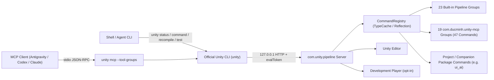

# Architecture

`com.ducminh.unity-mcp` (`0.2.0`) builds directly on Unity's official **`unity` CLI**
and **`com.unity.pipeline`** (`1.0.1`) instead of maintaining a custom Python
gateway or HTTP bridge. Unity owns command discovery, JSON Schema generation,
execution, and loopback security; the `unity` CLI owns process discovery,
CLI command invocation, and stdio MCP hosting (`unity mcp`).

## Process and discovery model

- **Instance discovery & auth**: `com.unity.pipeline` writes an instance port
  descriptor to `<projectRoot>/Library/Pipeline/.unity-pipeline-port` (or
  `.unity-pipeline-runtime-port` beside a development Player) containing the
  loopback port and `evalToken`. Only `unity` CLI reads `evalToken` and speaks
  authenticated loopback HTTP (`127.0.0.1`) to the running Editor or Player.
- **Editor UI (`Window > UnityMCP > Tools`)**: `UnityCliDiscovery` detects the
  `unity` executable, probes `unity --version` asynchronously off the UI thread,
  reads `Library/Pipeline/.unity-pipeline-port` via `JsonTextReader` while
  explicitly skipping `evalToken`, and lists non-built-in `[CliGroupCommand]` /
  `[CliCommand]` commands discovered via `TypeCache`.
- **Token-free client setup**: `UnityMcpJsonProjectConfig` (`.agents/mcp_config.json`,
  `.mcp.json`) and `UnityMcpCodexProjectConfig` (`.codex/config.toml`) configure
  the `"unity"` stdio MCP server (`unity mcp --tool-groups --project-path <projectRoot>`),
  stripping any legacy HTTP URLs or bearer headers. Client setup also installs
  managed `unity-mcp` skills/rules and Antigravity's `AGENTS.md` block.

## Assembly boundaries and package gating

| Assembly | References | Purpose |
|---|---|---|
| `DucMinh.UnityMcp.Runtime` | `Unity.Pipeline.Attributes`, `Unity.Newtonsoft.Json` | 9 Runtime+Editor commands (`particle` create/get/configure/preview, `physics_ext`, `navmesh_ext`) and `RuntimeCommandHelpers`. |
| `DucMinh.UnityMcp.Editor` | `Unity.Pipeline.Attributes`, `Unity.Pipeline`, `Unity.Pipeline.Editor`, `DucMinh.UnityMcp.Runtime`, `UnityEngine.UI` | 38 Editor commands, `UnityCliDiscovery`, `UnityMcpToolsWindow`, project config/rule/skill writers, and `EditorCommandHelpers`. |
| `DucMinh.UnityMcp.Editor.Tests` | `Unity.Pipeline.*`, `DucMinh.UnityMcp.*`, `UnityEngine.UI` | EditMode tests for core command logic, discovery, and config/rule/skill writers. |

`DucMinh.UnityMcp.Runtime.asmdef` intentionally references **only** `Unity.Pipeline.Attributes`
(which has no `defineConstraints`) and **never** references `Unity.Pipeline` or
`UnityEditor`. Non-development Release Player builds compile cleanly with zero
Pipeline server code when **Project Settings > Pipeline > Runtime** toggles are off.

Optional package commands inside `DucMinh.UnityMcp.Editor` are guarded by
`versionDefines` symbols in `DucMinh.UnityMcp.Editor.asmdef`:

- `DM_ADDRESSABLES_PRESENT` (`com.unity.addressables`) -> `addressables` (5)
- `DM_LOCALIZATION_PRESENT` (`com.unity.localization`) -> `localization` (3)
- `DM_TERRAIN_PRESENT` (`com.unity.modules.terrain`) -> `terrain` (2)
- `DM_2D_SPRITE_PRESENT` (`com.unity.2d.sprite`) -> `sprite` (1)
- `DM_TILEMAP_PRESENT` (`com.unity.modules.tilemap`) -> `tilemap` (1)
- `DM_PROBUILDER_PRESENT` (`com.unity.probuilder`) -> `probuilder` (2)
- `DM_CINEMACHINE_PRESENT` (`com.unity.cinemachine`) -> `cinemachine` (1)
- `DM_VFXGRAPH_PRESENT` (`com.unity.visualeffectgraph`) -> `vfxgraph` (1)
- `DM_INPUTSYSTEM_PRESENT` (`com.unity.inputsystem`) -> `input_actions` (2)

Optional SDK integrations resolve types via reflection inside their `#if DM_*_PRESENT`
guard so `DucMinh.UnityMcp.Editor` needs no extra hard `.asmdef` assembly references.
Independent companion packages (such as `com.ducminh.ui-maker` providing `ui_ai`)
ship their own `com.unity.pipeline`-gated assemblies and are discovered automatically.

## Command execution and concurrency

- Commands declare `[CliGroupCommand(group, description, Name = ..., Effect = ..., Tags = ...)]`
  and take `CommandContext` first, returning `ExitCode` or `Task<ExitCode>`.
- `MainThreadRequired` defaults to `true`; `com.unity.pipeline` marshals calls to
  Unity's main thread. Long operations (such as `addressables build`) return
  `async Task<ExitCode>`, yield frames with `await Task.Yield()`, and honor
  `cmd.CancellationToken` (supporting synchronous execution or `unity command --detach`).
- Scene/object mutations wrap edits in `AuthoringUndoScope` for single-step Undo.
- `visual_ext` (`capture_gameobject`, `capture_multiview`) uses
  `EditorCommandHelpers.WriteCapturedPng`: when no output path is given, PNGs
  write under `Temp/` and return inline `base64`; when an output path is specified,
  inline `base64` is omitted unless `--include-inline-image true` is passed.

## Catalog validation contract

`docs/tool-catalog.json` is the repository CI contract for the 47 extension
commands across 19 groups. `tools/validate_catalog.py` scans every C# file in
`Packages/com.ducminh.unity-mcp` (excluding `Samples~` and `Tests`), verifies
exact 1:1 parity with `docs/tool-catalog.json` (`(group, name)` and `Effect`),
checks for duplicate commands or reserved `[CliArg]` flag names, and asserts zero
group collisions with `com.unity.pipeline`'s 23 built-in groups.
